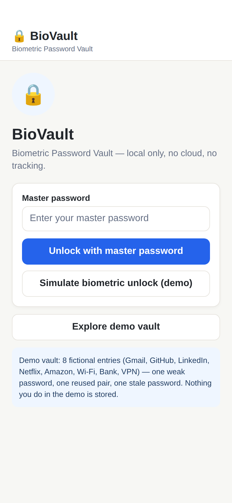
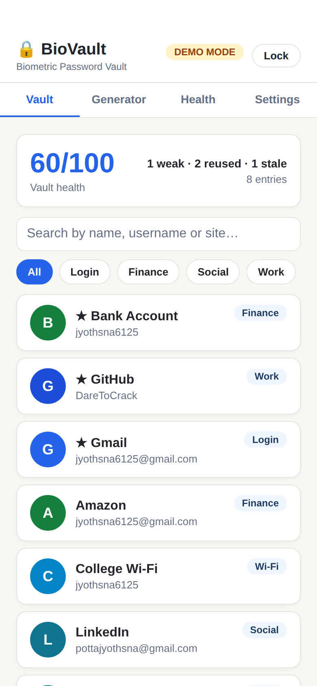
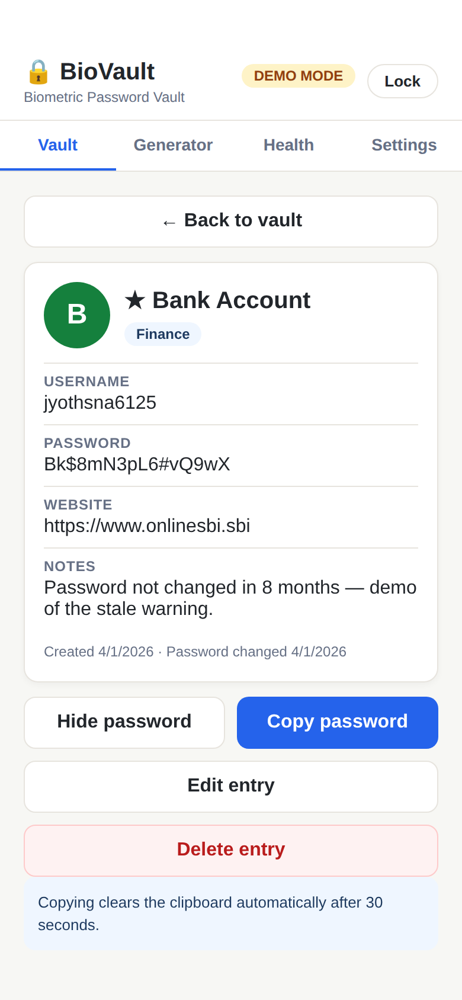
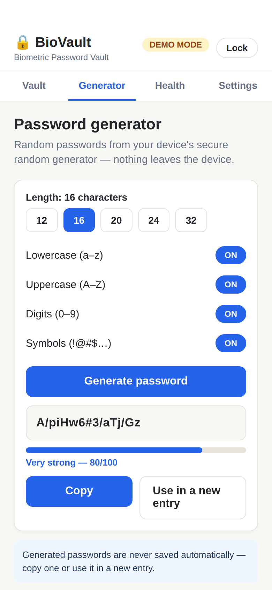

# 🔒 BioVault — Biometric Password Vault

[](https://docs.expo.dev/)
[](#testing)
[](LICENSE)
[](#threat-model)

A **local-only password vault** for Android, iOS and web. Unlock it with your
fingerprint or face; every stored password is encrypted on the device with
AES-256-GCM. No account, no server, no analytics, no cloud sync — by design.

> **Demo first:** the whole UI runs without a device. Open the web demo and
> tap **Explore demo vault** (or add `?demo=vault` to the URL) to explore
> 8 fictional entries, including one weak, one reused pair and one stale
> password.

---

## Screenshots

| Lock | Vault |
| --- | --- |
|  |  |

| Entry detail | Password generator |
| --- | --- |
|  |  |

---

## Features

- **Setup & unlock** — master password with a strength meter (PBKDF2-SHA-256,
  600,000 iterations, 16-byte salt — the same parameters as
  [SecureShare](https://github.com/DareToCrack/secureshare)). The master
  password itself is never stored — only a PBKDF2-derived verification hash.
- **Biometric unlock** — fingerprint / face via `expo-local-authentication`.
  The vault key is kept in `expo-secure-store` and released only after a
  successful biometric prompt. Master-password fallback is always available.
- **Vault** — add / edit / delete entries (site or app, username, password,
  URL, category, notes, favourite), search, filter by category, copy with
  **auto-clear after 30 seconds**.
- **Password generator** — length 8–32, lowercase / uppercase / digits /
  symbols, strength meter with entropy estimate, one-tap copy, and
  "Use in a new entry".
- **Security analysis (all local, no network)** — weak-password detection
  (common-password list, length, strength score), reused-password detection
  (SHA-256 hash comparison — passwords are never compared in plaintext),
  stale-password age warnings (> 180 days), shown as a 0–100 vault health
  summary: −15 per weak, −10 per reused, −5 per stale.
- **Auto-lock** — locks after 2 minutes of inactivity and immediately when
  the app goes to the background. Locking clears the vault key and all
  decrypted entries from memory.
- **Encrypted backup** — export / import the whole vault as one encrypted
  JSON file (AES-256-GCM, unlocked with the master password). The backup file
  is useless without the master password.
- **Demo mode** — 8 fictional entries + "simulate biometric unlock", so the
  whole UI is verifiable without a device. Nothing done in the demo is stored.

---

## Crypto design

One random 256-bit vault key per vault, wrapped by a KEK derived from the
master password. Every entry is encrypted separately with a fresh random
12-byte IV; SQLite stores ciphertext + IV + SHA-256 hash only — **passwords
are never stored in plaintext**.

```
master password
  └─ PBKDF2-SHA-256, 600,000 iterations, 16-byte salt
       └─ KEK (AES-256-GCM)
            ├─ wraps the random 256-bit vault key  → expo-secure-store / localStorage
            └─ verification hash (SHA-256 of the KEK) → SQLite meta table

vault key (random, per vault)
  └─ AES-256-GCM, fresh 12-byte IV per entry, SHA-256 integrity check
       └─ one encrypted row per entry in SQLite (ciphertext + IV + hash)

biometric path (native only)
  └─ raw vault key stored in expo-secure-store with requireAuthentication,
     so the OS only releases it after a fingerprint / face prompt
```

### What runs where

| Platform | Crypto implementation |
| --- | --- |
| **Web** | The browser's real **WebCrypto API** (`crypto.subtle`). SQLite runs on `wa-sqlite` (WebAssembly) and needs COEP/COOP headers — see [Web export](#web-export) below. |
| **Android / iOS** | **There is no built-in WebCrypto in React Native.** The app installs the same API surface onto `globalThis.crypto` at startup (`app/src/crypto/shim.native.js`): [`react-native-webcrypto`](https://www.npmjs.com/package/react-native-webcrypto) `1.0.0-alpha.3` (a real native WebCrypto implementation) plus `react-native-get-random-values` for `crypto.getRandomValues`. This is the exact pattern used by the sibling project SecureShare. The rest of the code (`src/crypto/core.js`) is WebCrypto-only and identical on every platform. |

`src/crypto/polyfill-note.js` documents this split in the source.

### Threat model

**Protects against**

- Someone reading the database file (stolen phone backup, lost device, a
  curious app): every password is AES-256-GCM ciphertext; the key is wrapped
  by a KEK only the master password can derive.
- Tampering: every stored row carries a SHA-256 hash checked before
  decryption, and GCM's authentication tag rejects any modified ciphertext.
- Shoulder-surfing / clipboard snooping: copied passwords auto-clear after
  30 seconds; the vault auto-locks after 2 minutes idle or on background.
- A wrong master password: the KEK verification hash is checked before any
  decryption is attempted; the vault key is never tried against a wrong KEK.

**Does NOT protect against**

- A compromised device: if malware can read the process memory while the
  vault is unlocked, or log keystrokes, no vault can help. Keep the OS
  patched and don't install apps from untrusted sources.
- A weak master password: the whole vault is only as strong as the master
  password. PBKDF2 at 600,000 iterations slows guessing, it does not make
  `password123` safe.
- Biometric coercion: anyone who can hold your finger to the sensor, or show
  your face to the camera, can unlock the vault. Use the master password
  (and disable biometrics) if that is a concern.
- **No breach-database lookup**: the health check is local only — weak /
  reused / stale detection. It cannot tell you whether a password appeared
  in a public breach; that would require sending hashes to a service, which
  this app refuses to do.

---

## Install & run

### On a phone (Expo Go)

```bash
cd app
npx expo start
```

Scan the QR code with **Expo Go**. The vault, SQLite and the master-password
flow work in Expo Go. Biometrics work in Expo Go for fingerprint (Android)
and Touch ID, with a limitation: `requireAuthentication` in SecureStore is
not supported in Expo Go when biometrics are available — see
[Limitations](#limitations). **Face ID on iOS needs a development build**
(`npx expo run:ios`), because Expo Go does not include the Face ID
entitlement.

### Development build (recommended for biometrics)

```bash
cd app
npx expo prebuild
npx expo run:android   # or: npx expo run:ios
```

### Web export

```bash
cd app
npx expo export --platform web
```

Then serve `dist/` **with COEP/COOP headers** (expo-sqlite on web needs
`SharedArrayBuffer`):

```bash
node /tmp/biovault-shots/serve.mjs 8081   # example static server with the headers
```

Biometrics are unavailable on web — the lock screen offers the master
password, a "simulate biometric unlock" demo button, and the demo vault.

**Demo deep-links** (web): `?demo=vault`, `?demo=entry`,
`?demo=generator`, `?demo=lock`.

---

## Architecture

```
biovault/
├── app/
│   ├── App.js                  # state machine: loading → setup → locked → unlocked
│   │                           # tabs: Vault / Generator / Health / Settings
│   ├── app.json                # BioVault, slug biovault, scheme biovault
│   ├── metro.config.js         # wasm assets + COEP/COOP headers (expo-sqlite web)
│   ├── index.js                # registerRootComponent
│   └── src/
│       ├── crypto/
│       │   ├── core.js         # WebCrypto-only: PBKDF2, AES-256-GCM, wrap/unwrap,
│       │   │                   # entry + backup encryption, SHA-256 integrity
│       │   ├── shim.js         # web: no-op (real WebCrypto exists)
│       │   ├── shim.native.js  # native: installs react-native-webcrypto
│       │   ├── polyfill-note.js# documents which crypto runs on each platform
│       │   └── index.js        # imports the shim, re-exports core
│       ├── vault/
│       │   ├── keyring.js      # key hierarchy: setup / unlock / biometrics /
│       │   │                   # change master password
│       │   ├── keyStore.native.js  # expo-secure-store (incl. OS-gated copy)
│       │   ├── keyStore.web.js     # localStorage for the wrapped key only
│       │   ├── store.js        # VaultStore: CRUD over an adapter, per-entry
│       │   │                   # encryption, favourites-first + name sort
│       │   ├── adapters.js     # MemoryAdapter (tests + demo)
│       │   ├── sqliteAdapter.js# expo-sqlite (meta + entries tables, WAL)
│       │   ├── generator.js    # password generator + strength scoring
│       │   ├── health.js       # weak / reused / stale analysis, health score
│       │   ├── common-passwords.js  # curated common-password list
│       │   ├── lock.js         # auto-lock rules (pure, testable)
│       │   └── demo.js         # 8 fictional demo entries
│       ├── auth/biometric.js   # expo-local-authentication wrapper (injected,
│       │                       # so it is unit-testable in Node)
│       └── ui/
│           ├── theme.js        # light palette
│           ├── components.js   # buttons, cards, fields, strength bar
│           ├── LockAndSetup.js # setup + lock screens
│           ├── VaultScreens.js # vault list + entry detail / edit
│           └── ToolsScreens.js # generator, health, settings
├── tests/                      # node:test suites (run from the project root)
└── docs/screenshots/           # lock, vault, entry, generator (Playwright)
```

**Storage layout**

- SQLite `meta` table: `salt` (16 bytes, base64url), `kek_verify_hash`
  (SHA-256 hex), `biometric_enabled` flag.
- SQLite `entries` table: `id`, `ciphertextB64url`, `ivB64url`, `sha256`,
  `createdAt`, `updatedAt`. No plaintext anywhere on disk.
- `expo-secure-store` (native) / `localStorage` (web): the wrapped vault key
  + IV (ciphertext only — the KEK is never stored). The biometric path keeps
  a second copy of the raw vault key behind `requireAuthentication`.

---

## Testing

```bash
npm test          # from the project root — node:test, 61 tests, all passing
```

Coverage: crypto round-trips (encrypt/decrypt, wrong-key failure, tamper
detection, wrong stored hash, fresh IV each time), key derivation (same
salt/password deterministic, different salt/password differ), wrap/unwrap,
backup encrypt/decrypt + wrong-password failure, vault CRUD over the memory
adapter (including the proof that the adapter never sees plaintext),
validation, keyring setup/unlock/change-password/biometric enable-disable,
generator (character sets, length, strength scoring), weak/reused/stale
detection and health-score maths, lock behaviour (2-minute boundary, state
machine), and the biometric wrapper through a mock auth module.

The biometric **prompt itself cannot be tested in the sandbox** — it is
tested through a mock, and the on-device gap is listed under Limitations.

### Web export verification

`npx expo export --platform web` succeeds (310 modules, wa-sqlite wasm
bundled). The export was served locally with COEP/COOP headers and driven
in Chromium (Playwright) through the real setup flow — create vault, lock,
unlock — plus all four demo deep-links. All four screenshots were read back
and verified: light palette everywhere, readable text, realistic demo data,
**zero JavaScript errors**. The Health and Settings tabs were also exercised
(health 60/100 in the demo: 1 weak · 2 reused · 1 stale; settings shows the
honest "biometrics not available on web" note).

---

## Limitations (honest list)

- **Biometric unlock is unverified on a real device.** The flow is tested
  through a mock auth module; fingerprint/face prompting, the SecureStore
  `requireAuthentication` gate, and Face ID need on-device verification.
- **Native crypto is an alpha package.** `react-native-webcrypto`
  `1.0.0-alpha.3` is a real native WebCrypto implementation, but it is an
  alpha release and has not been verified on-device in this project.
- **Face ID needs a development build** (Expo Go does not include the
  entitlement). SecureStore `requireAuthentication` is not supported in
  Expo Go when biometrics are available.
- **No cloud sync by design** — there is no account and no server. Backups
  are the only way to move a vault to another device, and a lost master
  password means a lost vault: there is no recovery.
- **No breach-database lookup** — health analysis is local weak / reused /
  stale detection only.
- **Auto-lock timing is approximate** — the inactivity check runs every
  10 seconds, so locking can happen up to ~10 seconds after the 2-minute mark.
- **Web storage is weaker than native**: the wrapped key lives in
  `localStorage` and the vault survives reload, but the web vault is only as
  safe as the browser profile. On native, the wrapped key lives in the OS
  keychain / keystore.
- **No Dockerfile**: this is a client app (Expo/React Native). It has no
  server component, so there is nothing to containerise — the web export is
  static files served by any static host.

---

## License

MIT — see [LICENSE](LICENSE).
